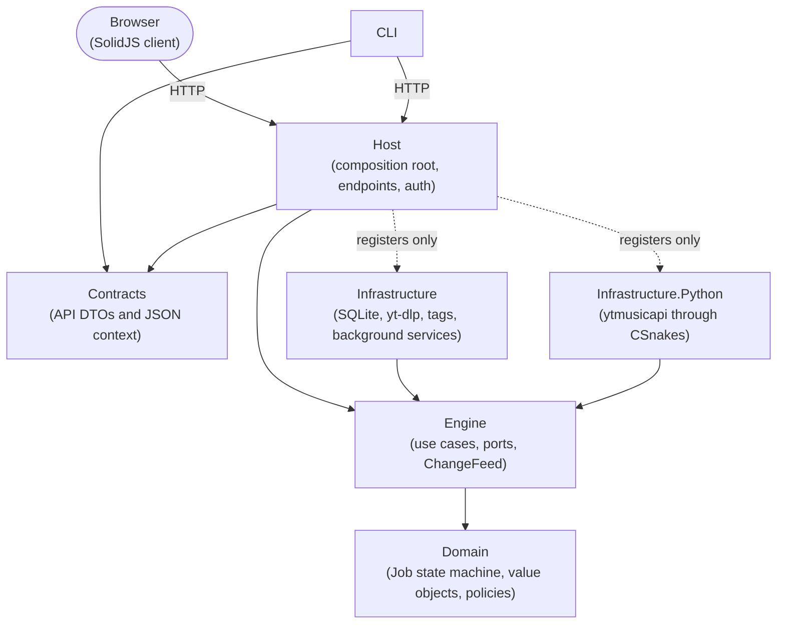

# Architecture

YGrab downloads albums and tracks from YouTube Music as tagged audio, or one YouTube video.

## Layers

The edges are enforced by the `eng/BannedSymbols.*.txt` files and architecture tests.

Domain is pure: no I/O, time or randomness. The Cli never touches the Engine or SQLite: the job runner and the SQLite writer live in the Host.

## Conventions

- A use case goes to one file holding its `Command` or `Query`, its `Handler` and a `union` of outcomes. There is no mediator.
- The Domain owns every policy. An adapter only translates I/O and classifies errors into a `RemoteFailure`.
- A limit, a timeout or a pause is a named constant. Docs name the constant, never its value.

## Jobs

`Job` is an immutable state machine. Jobs live in memory and are saved to SQLite on each transition, so a restart resumes them. A file that is complete on disk is never downloaded again.

## Rate limits

Every request comes from the VPS address, and a flagged address stays flagged. One job runs one step at a time, with a pause after each request, a backoff on transient errors and a global cooldown on rate limits. Change these values only for a reason that comes from YouTube's behavior.

## Telemetry

The Engine and the adapters emit spans and metrics through the BCL `ActivitySource` and `Meter` named `YGrab`, so no layer below the Host references OpenTelemetry. The Host exports them over OTLP only when `OTEL_EXPORTER_OTLP_ENDPOINT` is set. A job id goes on spans only, never on metrics.
