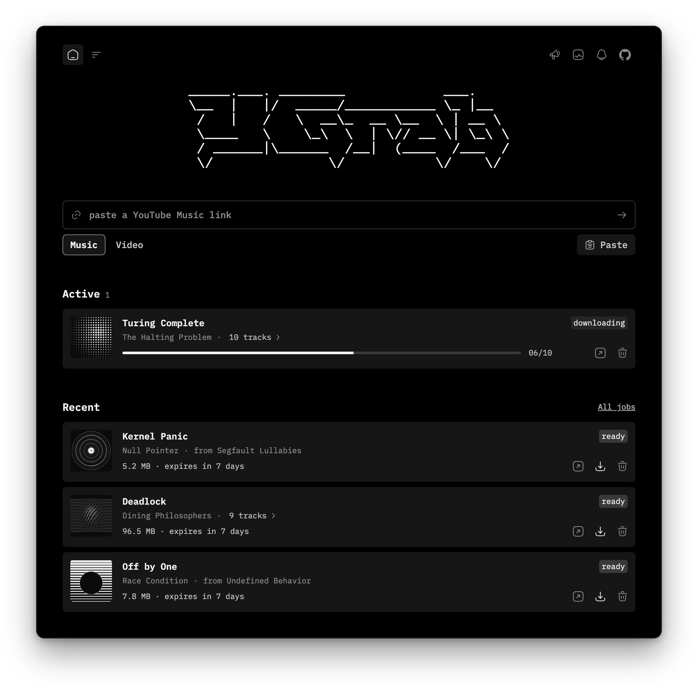

<!-- rumdl-disable-file MD033 MD041 -->
<div align="center">

# YGrab

A self-hosted web app for downloading tagged albums and tracks from YouTube Music

[](https://github.com/thomas-fazzari/ygrab/actions/workflows/ci.yml)
[](https://github.com/thomas-fazzari/ygrab/releases/latest)
[](https://github.com/thomas-fazzari/ygrab/pkgs/container/ygrab)
[](LICENSE)

[Install](#install) · [Configuration](#configuration) · [CLI](#cli) · [Development](#development)



</div>

## Features

- Albums and tracks keep the audio stream YouTube serves (Opus or M4A), with no re-encoding. Albums come as a zip with the tracks and the cover.
- Any YouTube video downloads as MP4, or MKV when the streams don't fit in MP4. Cap the resolution between 720p and 2160p, take the best available, or keep the audio only.
- Tracks are tagged with title, artists, album, track number and a square cover. When Deezer knows the release, it fills in the disc number, release date, label, barcode and ISRC.
- Jobs live in a persistent queue that survives restarts. Pasting a link that an earlier job already covers, such as a track from an album you grabbed, opens that job, and you can still download it again.
- Requests to YouTube are spaced 5 to 15 seconds apart, and the queue pauses when YouTube rate-limits you.
- Finished files are deleted after 7 days, or 2 days for videos. Both delays are configurable.

## Install

The Docker image runs on `amd64` and `arm64`. Save this as `compose.yaml`:

```yaml
services:
  ygrab:
    image: ghcr.io/thomas-fazzari/ygrab:latest
    restart: unless-stopped
    read_only: true
    tmpfs:
      - /tmp
      - /home/app:uid=1654,gid=1654
    cap_drop:
      - ALL
    security_opt:
      - no-new-privileges:true
    ports:
      - "127.0.0.1:8080:8080"
    volumes:
      - data:/data

volumes:
  data:
```

The root filesystem is read-only. The container only writes to the data volume and the two `tmpfs` mounts. The port is bound to localhost, so it is not reachable from other machines.

To expose it on your network without a reverse proxy, use `"8080:8080"` instead.

Then start it:

```sh
docker compose up -d
```

On first start, the server generates an access token and stores it in the data volume. Get it with `docker compose exec ygrab cat /data/auth-token`, open `http://localhost:8080` and sign in. To pick your own token, set `YGRAB_TOKEN` (16 characters minimum) under `environment`.

To update the app and its bundled yt-dlp, run `docker compose pull && docker compose up -d`.

The server only speaks plain HTTP. To expose it to the internet, run a reverse proxy with HTTPS on the same host.

## Configuration

Every setting and its default is in [`ygrab.example.yaml`](ygrab.example.yaml). Override a setting as an environment variable in `compose.yaml`, with `__` between section and key, such as `Jobs__RetentionDays: 14`. You can also put your overrides in a `ygrab.yaml` mounted at `/app/ygrab.yaml`. Don't set `Urls`: the image already sets the port.

If YouTube asks you to sign in, export the cookies of a logged-in browser to `cookies.txt`, copy the file into the volume with `docker compose cp cookies.txt ygrab:/data/cookies.txt`, and set `YtDlp__CookiesFile: /data/cookies.txt`.

## Telemetry

YGrab can send traces, metrics and logs to any OpenTelemetry backend. Set `OTEL_EXPORTER_OTLP_ENDPOINT` under `environment`, such as `http://otel-collector:4317`, to enable it.

Available metrics:

| Metric                     | Tags                       | Shows                                                                  |
| -------------------------- | -------------------------- | ---------------------------------------------------------------------- |
| `ygrab.job.step.duration`  | `ygrab.step`, `error.type` | The duration of each step, and its failures by kind                    |
| `ygrab.ytdlp.warnings`     | `error.type`               | The page and API calls that yt-dlp retries or that YouTube rate-limits |
| `ygrab.cooldown.strikes`   |                            | The rate limits since the last packaged job                            |
| `ygrab.jobs`               | `ygrab.job.state`          | The jobs by state                                                      |
| `ygrab.enrichment.lookups` | `ygrab.enrichment.outcome` | The Deezer lookups by outcome                                          |

## CLI

The `ygrab` CLI talks to the same server from your terminal. On Linux or macOS, this installs it to `~/.local/bin`:

```sh
curl -fsSL https://raw.githubusercontent.com/thomas-fazzari/ygrab/master/install-cli.sh | sh
```

On Windows, grab `ygrab-win-x64.exe` from the [latest release](https://github.com/thomas-fazzari/ygrab/releases/latest), rename it to `ygrab.exe` and put it somewhere on your `PATH`. Then:

```sh
ygrab login https://ygrab.example.com
ygrab add --wait 'https://music.youtube.com/playlist?list=...'
```

`login` prompts for the token. `add --wait` follows the jobs and saves each file to the current directory. Run `ygrab --help` for the other commands: `ls`, `show`, `watch`, `get`, `retry`, `rm` and `resume`.

## Development

Start with [`ARCHITECTURE.md`](ARCHITECTURE.md) and [`AGENTS.md`](AGENTS.md). The tooling runs on [mise](https://mise.jdx.dev): `mise install` sets up the tools, `mise run dev` starts the server and the web app, and `mise run check` runs all checks. `mise run dev:aspire` starts both through the Aspire AppHost in [`tools/YGrab.AppHost`](tools/YGrab.AppHost), with the traces, metrics and logs in its dashboard.

## License

[AGPL-3.0-or-later](LICENSE)
